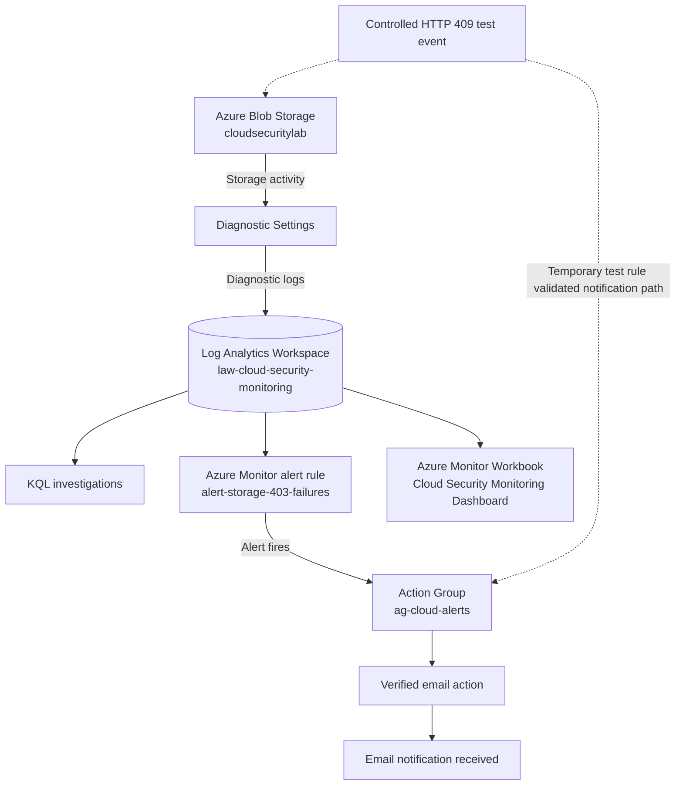

# Azure Cloud Security Monitoring Lab

A hands-on cloud security monitoring project built with Microsoft Azure. This lab demonstrates how Azure Storage diagnostic logs can be collected centrally, investigated with Kusto Query Language (KQL), monitored with Azure Monitor alert rules, and visualized in an Azure Monitor Workbook.

> **Project status:** Azure implementation and alert-notification testing completed. Repository documentation and evidence publication are in progress.

## Architecture

The following diagram shows the data flow and the monitoring/alerting paths implemented in this lab.



### Workflow

1. **Generate storage activity** — Blob operations generate storage diagnostic events.
2. **Collect logs** — Azure Storage Diagnostic Settings route the configured logs to Log Analytics.
3. **Investigate events** — KQL queries filter and summarize storage requests, including failed HTTP status codes.
4. **Evaluate alerts** — Azure Monitor evaluates the configured log alert query and threshold.
5. **Notify** — The Action Group sends an email when its associated alert fires.
6. **Visualize** — The Azure Monitor Workbook presents storage request and failure summaries.

## Azure resources

| Component | Resource / configuration |
|---|---|
| Cloud platform | Microsoft Azure |
| Subscription | Azure for Students |
| Resource group | `rg-cloud-iam-lab` |
| Storage account | `cloudsecuritylab` |
| Storage region | UAE North |
| Log Analytics workspace | `law-cloud-security-monitoring` |
| Action Group | `ag-cloud-alerts` |
| Action Group display name | `CloudAlert` |
| Permanent alert rule | `alert-storage-403-failures` |
| Workbook | `Cloud Security Monitoring Dashboard` |
| Log table | `StorageBlobLogs` |

## Implementation

### 1. Storage diagnostic logging

Configured Azure Storage diagnostic settings to send the selected Blob service logs to the Log Analytics workspace. This provides a centralized location for querying storage activity.

### 2. KQL investigations

The following examples were used during the lab.

**Find HTTP 403 responses in the last five minutes**

```kusto
StorageBlobLogs
| where TimeGenerated > ago(5m)
| where StatusCode == 403
```

**Find successful HTTP 2xx responses**

```kusto
StorageBlobLogs
| where TimeGenerated > ago(24h)
| where toint(StatusCode) between (200 .. 299)
| summarize RequestCount = count() by OperationName
| order by RequestCount desc
```

**Summarize requests by HTTP status code**

```kusto
StorageBlobLogs
| where TimeGenerated > ago(24h)
| summarize RequestCount = count() by StatusCode
| order by RequestCount desc
```

**Controlled HTTP 409 validation query**

```kusto
StorageBlobLogs
| where TimeGenerated > ago(5m)
| where toint(StatusCode) == 409
```

The 409 query was used for a temporary validation alert, not as the permanent production alert.

### 3. Azure Monitor alert

The permanent alert rule is configured to monitor HTTP 403 responses.

| Setting | Value |
|---|---|
| Rule name | `alert-storage-403-failures` |
| Severity | Sev 2 – Warning |
| Query condition | HTTP 403 responses |
| Threshold | More than 5 matching records |
| Evaluation frequency | 5 minutes |
| Query time range | 5 minutes |
| Action Group | `ag-cloud-alerts` |
| State | Enabled |

Alert query:

```kusto
StorageBlobLogs
| where TimeGenerated > ago(5m)
| where StatusCode == 403
```

### 4. Action Group and email notification

Created the Action Group `ag-cloud-alerts` with display name `CloudAlert`. Its email action, `security-email-alert`, was verified.

When an associated alert fires, Azure Monitor invokes this Action Group to deliver an email notification.

### 5. Monitoring workbook

Created an Azure Monitor Workbook named **Cloud Security Monitoring Dashboard** to review storage activity, successful requests, failed requests, and request summaries.

## Testing and validation

A controlled HTTP 409 test was used to validate the end-to-end alert notification path.

- Temporary test rule: `alert-storage-409-test`
- Test query filtered for HTTP 409 responses.
- Threshold: greater than 5.
- Observed metric value in the fired alert notification: **14**.
- Alert state: **Fired**.
- Email notification: **received successfully**.
- Cleanup: the temporary 409 test rule was deleted after validation.

The permanent HTTP 403 alert rule remains enabled. The temporary 409 rule was only a test mechanism; it is not part of the final deployed configuration.

## Evidence

Screenshots will be published in the `evidence/` directory. The planned evidence set is:

| File | What it demonstrates |
|---|---|
| `02-log-analytics-workspace.png` | Log Analytics workspace overview |
| `03-storage-diagnostic-settings.png` | Storage diagnostic settings |
| `08-alert-email-notification.png` | Successful alert email delivery |
| `09-final-alert-rules.png` | Final alert rule configuration |
| `10-action-group-email.png` | Action Group and verified email action |
| `11-cloud-security-monitoring-dashboard.png` | Azure Monitor Workbook |
| `12-kql-successful-requests.png` | Successful request analysis |
| `13-kql-failed-requests.png` | Failed request analysis |
| `14-kql-request-summary.png` | Request summary |

> Evidence files are not included until they are uploaded to this repository.

## Repository structure

```text
azure-cloud-security-monitoring-lab/
├── README.md
└── evidence/
    ├── 02-log-analytics-workspace.png
    ├── 03-storage-diagnostic-settings.png
    ├── 08-alert-email-notification.png
    ├── 09-final-alert-rules.png
    ├── 10-action-group-email.png
    ├── 11-cloud-security-monitoring-dashboard.png
    ├── 12-kql-successful-requests.png
    ├── 13-kql-failed-requests.png
    └── 14-kql-request-summary.png
```

## Skills demonstrated

- Azure Storage monitoring and diagnostic logging
- Azure Monitor and Log Analytics
- Kusto Query Language (KQL)
- Log-based alert configuration
- Action Groups and email notifications
- Azure Monitor Workbooks
- Cloud activity investigation and alert validation

## Learning outcomes

This project provided practical experience in building a centralized Azure monitoring workflow, querying storage diagnostic events, configuring a log-based alert, validating notification delivery, and presenting monitoring information in a workbook.

## Security note

This repository documents an educational lab. No subscription IDs, credentials, access keys, SAS tokens, personal email addresses, or other secrets should be committed. Resource names and configuration details are included for portfolio and learning purposes.
